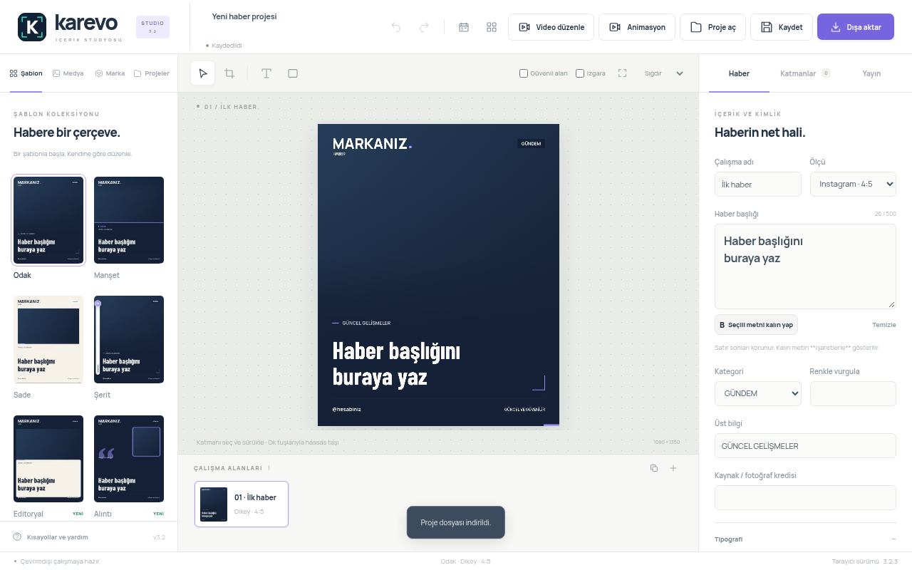

<div align="center">
  

  **Hikâyeni tasarla, düzenle ve paylaşmaya hazırla.**

  Haber görsellerinden kısa videolara, sosyal medya içeriklerini tek bir çalışma alanında hazırla.

  [**⬇ Windows için indir · 3.2.3**](https://github.com/Yusufozkal/karevo/releases/download/karevo-v3.2.3-preview/Karevo-3.2.3-Setup.exe) &nbsp; · &nbsp; [**⬇ Android için indir · 3.1.3**](https://github.com/Yusufozkal/karevo/releases/download/karevo-v3.2.3-preview/Karevo-3.1.3-Android.apk) &nbsp; · &nbsp; [Sürüm bilgileri](https://github.com/Yusufozkal/karevo/releases/tag/karevo-v3.2.3-preview) &nbsp; · &nbsp; [Kurulum](#kurulum) &nbsp; · &nbsp; [Güncellemeler](#güncellemeler)

  Windows 10 / 11 · 64 bit &nbsp; • &nbsp; Android 8+ &nbsp; • &nbsp; Manuel kurulum
</div>

---

## Fikrinden paylaşıma

Karevo; içerik üreticileri, haber sayfaları ve kendi markası için paylaşım hazırlayanlar için bir görsel ve video içerik düzenleyicisidir. Hazır şablonlarla başlayabilir, kendi görsellerini ve marka öğelerini kullanarak tasarımını kişiselleştirebilirsin.

| Tasarla | Video düzenle | Düzenini koru |
| --- | --- | --- |
| Hazır şablonlar, metin, şekil ve görsel katmanlarıyla içerik oluştur. | Tek klibi zaman çizelgesinde kes; kadraj, yazı ve ses ayarlarını düzenle. | Marka profillerini kullan, projelerini kaydedip çalışmana daha sonra devam et. |

- **İçeriğine uygun görünüm:** Kendi logonu, renklerini ve görsellerini kullan.
- **Paylaşıma hazır çıktılar:** Görselleri PNG veya JPG olarak dışa aktar; birden fazla çıktıyı toplu hazırla.
- **Kısa videolar ve animasyonlar:** Videonun başlangıç ve bitişini zaman çizelgesinden seç, oynatma konumunu kontrol et ve animasyonlu içerikler hazırla.
- **Kendi çalışma alanın:** Projelerini kaydedip daha sonra düzenlemeye devam et. Video işleme cihazında yapılır.



Video düzenleyici tek kliple çalışır. Kaynak video en fazla 5 dakika ve 120 MiB, çıktı ise 0,25–60 saniye olabilir. MP4 ve WebM desteği cihazın kodlayıcılarına göre değişebilir.

## Kurulum

**Windows**

1. [Karevo Windows kurucusunu indir](https://github.com/Yusufozkal/karevo/releases/download/karevo-v3.2.3-preview/Karevo-3.2.3-Setup.exe).
2. İndirilen `Karevo-3.2.3-Setup.exe` dosyasını aç ve kurulum adımlarını izle.
3. Uygulamayı aç, bir şablon seç ve ilk tasarımını oluştur.

**Gereksinim:** Windows 10 veya Windows 11, 64 bit. Kurulumdan önce mevcut çalışmalarını proje dosyası olarak yedekle.

**Android**

[Karevo Android APK’sını indir](https://github.com/Yusufozkal/karevo/releases/download/karevo-v3.2.3-preview/Karevo-3.1.3-Android.apk), dosyayı aç ve kurulum adımlarını izle. Android 8 veya üzeri gerekir. Karevo yeni, bağımsız bir uygulama olarak eski sürümün yanında kurulur. Eski uygulamadaki çalışmalarını proje dosyası olarak dışa aktararak Karevo’da açabilirsin.

**Projeler:** Yeni kayıtlar `.karevo` uzantısını kullanır. Eski `.bulten` ve `.netice` projeleri de açılabilir.

<details>
<summary>Windows uyarısı ve doğrulama bilgileri</summary>

Kurucu henüz Windows yayıncı sertifikasıyla imzalanmadığı için Microsoft Defender SmartScreen bir uyarı gösterebilir. Kurucu içeriği ve dosya bütünlüğü kontrol edilmiştir; bu sürümün kurulumu gerçek bir Windows cihazında henüz doğrulanmadı.

</details>

## Güncellemeler

Karevo 3.2.3 şu anda manuel kurulumla sunuluyor; yukarıdaki kurucuyu indirerek kurabilirsin. Bu sürüm otomatik güncelleme kanalına eklenmedi. Android sürümü de bu sayfadaki APK ile elle güncellenir.

Uygulamanın **Güncellemeler → Güncelleme ayarları** bölümünde kullanılabilecek depo adresi:

```text
https://github.com/Yusufozkal/karevo
```

Otomatik denetim açıksa uygulama imzalı kanalda yayımlanan sürümleri kontrol eder; indirme ve kurulumu sen başlatırsın. Güncelleme bilgileri imza ile doğrulanır; indirilen kurucunun boyutu ve dosya özeti kontrol edilir. Bu doğrulama, Windows yayıncı sertifikasının yerini almaz.

## Sürümler ve arşiv

[Karevo 3.2.3 sürümünü görüntüle](https://github.com/Yusufozkal/karevo/releases/tag/karevo-v3.2.3-preview) · [Tüm sürümler](https://github.com/Yusufozkal/karevo/releases)

Bu depo Karevo Windows ve Android kurucularının dağıtımı içindir; uygulamanın kaynak kodu burada yayımlanmaz.

<details>
<summary>Önceki sürümler ve mevcut projelerle uyumluluk</summary>

Karevo, daha önce Bülten Studio adıyla sunuluyordu. Eski adla yayımlanan sürümler arşiv olarak korunur; imzalı otomatik kanaldaki son yayın 3.2.1’dir. Karevo indirmek için bu sayfanın üstündeki bağlantıyı kullan.

Mevcut Windows verilerinin konumu korunur; eski proje dosyaları açılabilir. Android sürümü ayrı kurulur, eski uygulamanın verilerini otomatik taşımaz. 3.0 ve önceki sürümlerde güncel kurucuyu bir kez elle kurmak gerekir.

Eski depo adresi GitHub tarafından yeni adrese yönlendirilir. İmzalı arşiv dosyaları önceki sürümlerin güncelleme doğrulamasını korumak için değiştirilmez.

</details>
